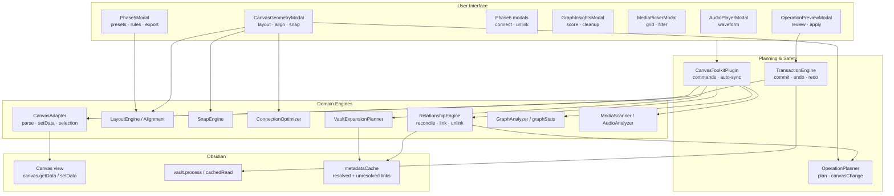
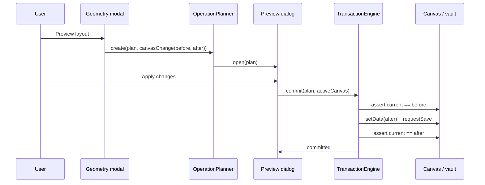
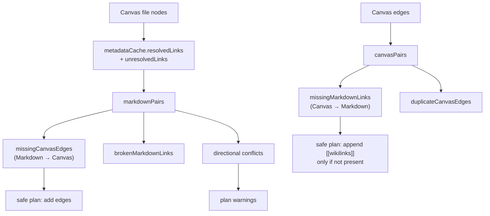

# System Architecture (`ARCHITECTURE.md`)
> **1-Line Summary:** Plain-English map of how the canvas adapter, planners, transaction engine, relationship sync, and media tools fit together, plus the checks and recipes needed to change it safely.

## 1. High-Level Visual System Map


## 2. Tech Stack & Why We Chose It
* **Language:** TypeScript 5.8 (`strict`, `noUncheckedIndexedAccess`), bundled to CommonJS by esbuild.
* **Host:** Obsidian plugin API, `minAppVersion` 1.1.0, desktop and mobile.
* **State:** one `data.json` blob with no explicit version; every load runs `normalizeSettings`.
* **Parsing:** a hand-written adapter around the JSON Canvas format, not a schema library, so unknown fields round-trip untouched.
* **Media:** native `HTMLAudioElement`, Web Audio `decodeAudioData`, and vault resource URLs; no external dependencies or network calls.

## 3. Module Responsibilities
### [SUBSYSTEM: Plugin-Entry-And-Commands] | Aliases: main.ts, onload, commands, auto sync
> **1-Line Summary:** `main.ts` wires settings, every command, the editor menu item, and the layout-ready auto-sync listeners.
* **Owns:** command registration, current canvas/target lookup, settings load/save/normalize, configuration import/export, media insertion dispatch, auto-sync dedupe.
* **Must not:** contain layout math, DOM builders for dialogs, or direct canvas mutation outside a plan.
* **Code Anchors (Grep Targets):** `src/main.ts` -> `onload`, `currentCanvas`, `openMediaPicker`, `handleAutoSync`, `normalizeSettings`

### [SUBSYSTEM: Canvas-Adapter] | Aliases: CanvasAdapter, parseData, toRawData, selection
> **1-Line Summary:** Converts the private canvas view object into a typed, lossless node/edge model and writes it back.
* **Owns:** safe coercion of node and edge fields, `extra` capture for unknown JSON Canvas keys, `strict` parse errors, selection id extraction from a Map or iterable.
* **Must not:** read or write files itself; persistence belongs to the transaction engine.
* **Code Anchors (Grep Targets):** `src/canvas/CanvasAdapter.ts` -> `fromView`, `parseData`, `toRawData`, `getSelectionIds`

### [SUBSYSTEM: Transaction-Engine] | Aliases: commit, undo, redo, state hash, rollback
> **1-Line Summary:** Applies a plan's before/after snapshots only if every target still matches what the preview saw, and rolls back on failure.
* **Owns:** the active-operation lock, canonical JSON comparison, deferred canvas writes via `setData` + `requestSave`, file writes via `vault.process`, undo/redo stacks trimmed to `journalLimit`.
* **Must not:** validate domain rules or build plans; it only transports them.
* **Code Anchors (Grep Targets):** `src/operations/TransactionEngine.ts` -> `commit`, `assertStateMatches`, `applyCanvas`, `applySnapshot`, `trim`

### [SUBSYSTEM: Operations] | Aliases: OperationPlanner, OperationPreviewModal, journal
> **1-Line Summary:** Builds immutable plans, renders the review dialog, and keeps an in-memory activity journal.
* **Owns:** plan ids and timestamps, deep-cloned snapshots, warnings, the apply button lifecycle, journal records.
* **Must not:** write to the vault or decide whether a change is safe.
* **Code Anchors (Grep Targets):** `src/operations/OperationPlanner.ts` -> `create`; `src/operations/OperationPreviewModal.ts` -> `applyChanges`; `src/operations/OperationJournal.ts` -> `record`

### [SUBSYSTEM: Geometry-Engines] | Aliases: LayoutEngine, Alignment, SnapEngine, ConnectionOptimizer
> **1-Line Summary:** Pure functions that return a new canvas model with moved nodes or re-anchored edges.
* **Owns:** five layouts, six alignment modes, two distribution axes, grid plus neighbor snapping, 16-way anchor scoring with crossing detection.
* **Must not:** mutate the input model, touch the DOM, or open dialogs.
* **Code Anchors (Grep Targets):** `src/layout/LayoutEngine.ts` -> `layout`; `src/layout/Alignment.ts` -> `align`, `distribute`; `src/routing/SnapEngine.ts` -> `snapNodes`; `src/routing/ConnectionOptimizer.ts` -> `optimize`

### [SUBSYSTEM: Relationship-Sync] | Aliases: reconcile, missing canvas edges, missing markdown links, conflicts
> **1-Line Summary:** Cross-checks canvas edges against vault wikilinks and produces plans that add only the missing side.
* **Owns:** file-node indexing, broken link detection, directional conflict reporting, appendix-only Markdown edits, semantic link add/remove.
* **Must not:** delete content, rewrite existing lines, or touch non-Markdown files for semantic mode.
* **Code Anchors (Grep Targets):** `src/relationships/RelationshipEngine.ts` -> `reconcile`, `planSafeReconciliation`, `planSemanticMarkdownLink`, `planRemoveSemanticMarkdownLink`

### [SUBSYSTEM: Graph-Analysis] | Aliases: GraphAnalyzer, graphStats, insights, expansion
> **1-Line Summary:** Computes counts, duplicates, isolates, components, density, and health insights, and plans vault expansion.
* **Owns:** adjacency maps, insight tones, health deduction rules, duplicate-pair keys, BFS expansion with budgets.
* **Must not:** persist anything or change node positions outside an expansion plan.
* **Code Anchors (Grep Targets):** `src/graph/GraphAnalyzer.ts` -> `analyze`; `src/phase5.ts` -> `graphStats`; `src/phase7.ts` -> `analyzeGraph`, `healthScore`; `src/graph/GraphExpansionPlanner.ts` -> `plan`

### [SUBSYSTEM: Media] | Aliases: MediaScanner, MediaPickerModal, AudioAnalyzer, AudioPlayerModal
> **1-Line Summary:** Scans media by configured roots, renders the picker, analyzes audio waveforms, and inserts the result.
* **Owns:** extension classification, folder-prefix filtering, debounced search, grid rendering, waveform buckets and RMS, playback controls.
* **Must not:** write to the vault; insertion is handled by the plan created in `main.ts` or the editor selection.
* **Code Anchors (Grep Targets):** `src/media/MediaScanner.ts` -> `scan`; `src/media/MediaPickerModal.ts` -> `render`, `renderGrid`; `src/media/AudioAnalyzer.ts` -> `analyze`; `src/media/AudioPlayerView.ts` -> `AudioPlayerModal.onOpen`

### [SUBSYSTEM: Dialogs-And-Settings] | Aliases: CanvasGeometryModal, Phase5Modal, settings tab, folder picker
> **1-Line Summary:** The remaining UI: geometry controls, power tools, relationship dialogs, insights, the settings tab, and folder choice.
* **Owns:** control layout, validation notices, clipboard export/import, per-canvas rule selection, glassmorphism toggle.
* **Must not:** mutate settings without `saveSettings()`, or mutate the canvas without a plan.
* **Code Anchors (Grep Targets):** `src/ui/CanvasGeometryModal.ts` -> `onOpen`; `src/phase5.ts` -> `Phase5Modal`; `src/phase6.ts` -> `UniversalRelationshipModal`; `src/settings.ts` -> `CanvasToolkitSettingTab.display`

## 4. Settings Shape (`data.json`)
```json
{
  "mediaRoots": [],
  "mediaGridColumns": 3,
  "previewPdf": true,
  "defaultMediaKind": "all",
  "audioWaveformPoints": 180,
  "audioSeekSeconds": 10,
  "autoOptimizeConnections": false,
  "layoutGap": 80,
  "showMediaMetadata": true,
  "keepSelectionAfterInsert": false,
  "snapEnabled": true,
  "snapGridSize": 20,
  "syncMode": "off",
  "journalLimit": 50,
  "layoutPresets": [{ "name": "Research map", "kind": "mind-map", "gapX": 100, "gapY": 80 }],
  "canvasRules": [],
  "showGraphInsightsOnOpen": false,
  "defaultLinkMode": "visual",
  "glassmorphism": true
}
```
* There is no settings version field. `normalizeSettings` is the migration: unknown enums fall back, numeric ranges clamp, invalid presets/rules are dropped, and roots are normalized and deduplicated.
* `layoutPresets` and `canvasRules` are validated by shape, not by name, so user edits survive as long as the fields are correct.
* `canvasRules` is keyed by `canvasPath`; `setCanvasRule` replaces the existing entry rather than appending a duplicate.

## 5. Data Flow: Layout To Disk
### [FLOW: Preview-Commit] | Aliases: apply changes, review dialog, replace-canvas
> **1-Line Summary:** Geometry → plan → review → commit → verify, with the whole canvas as one before/after snapshot.

* For the active canvas the write is in-memory (`setData` + `requestSave`); background canvases are written through `vault.process` with a re-parse check.
* A commit failure triggers `applySnapshot(plan, 'before')` best-effort before rethrowing; the review dialog re-enables its button and shows the message.

## 6. Data Flow: Relationship Reconciliation
### [FLOW: Two-Way-Sync] | Aliases: markdown links, canvas edges, appendix
> **1-Line Summary:** Link metadata produces candidates; the safe plan adds canvas edges unconditionally and Markdown links only when absent.

* `syncMode` is evaluated per canvas (`canvasRules` first, then the global setting). **Apply** commits the safe plan without a preview; **Suggest** only shows a deduplicated notice.
* Conflict warnings never block the plan; they appear in the review dialog.

## 7. Data Flow: Media Insertion
### [FLOW: Media-Insert] | Aliases: picker, canvas anchor, markdown embed
> **1-Line Summary:** Scan once, pick items, then either insert `![[path]]` lines or create file nodes next to the selection.
* **Markdown:** `editor.replaceSelection` with one embed per line, then a journal entry.
* **Canvas:** clone the data, choose a grid anchored at `x + width + 80`, add `file` nodes (480×320 images, 520×360 otherwise), then open a review plan.
* **Media roots:** an empty list means the entire vault; otherwise a path must equal a root or start with `root/`.
* **Picker:** an image's natural size fills in the resolution caption after load; PDFs render in an iframe only when `previewPdf` is on.

## 8. Persistence And Concurrency Rules
### [STATE: Single-Active-Transaction] | Aliases: active flag, undo stack, stale state
> **1-Line Summary:** Only one commit, undo, or redo may run at a time, and every stack is trimmed to the configured journal limit.
* **Why:** Canvas writes trigger events that can re-enter auto-sync; overlapping transactions would interleave snapshots.
* **Staleness:** canonical JSON (sorted keys) is compared before writing, so formatting-only differences do not produce false conflicts.
* **Undo safety:** if the file no longer matches the committed state, undo throws and leaves history untouched rather than forcing user edits back.

## 9. Build & Verification
```bash
npm install
npx tsc -noEmit -skipLibCheck   # types
npm run lint                    # eslint, must be 0 errors
npm run build                   # tsc + esbuild -> main.js
```
* The built `main.js` is behaviorally identical to the live 1.0.0 bundle; only esbuild's minified identifier names differ.
* `runtime/` is the frozen fallback bundle; never build into it.
* Manual smoke test: open a canvas with 4+ cards, preview each layout, undo it, align/distribute, snap, optimize anchors, connect a node to a vault file, reconcile links, and insert one image plus one audio file.

## 10. Extension Recipes
### [RECIPE: Add-A-Layout] | Aliases: new algorithm, layout select, preset kind
> **1-Line Summary:** Add the algorithm, extend the kind union, then add it to the geometry select and preset validator.
1. Implement a private method on `LayoutEngine` that only mutates the cloned selected nodes.
2. Extend `LayoutKind` in `src/layout/LayoutEngine.ts` and the preset validator's allowed list in `src/main.ts`.
3. Add the option in `CanvasGeometryModal` and in the preset creator's select.
4. Verify with a two-node selection and a whole-canvas run, then undo both.

### [RECIPE: Add-A-Command] | Aliases: new command, checkCallback, review plan
> **1-Line Summary:** Register with `checkCallback`, bail out when no canvas is active, and route mutations through a plan.
1. Compute the condition from `currentCanvas()` and the selection before opening anything.
2. Build the before/after model, wrap it with `OperationPlanner`, and open `OperationPreviewModal` with the active adapter.
3. Never call `setData` directly; that bypasses verification, undo, and rollback.

### [RECIPE: Change-Persisted-Settings] | Aliases: normalize, defaults, data.json
> **1-Line Summary:** Add the field to the type and defaults, then clamp or validate it inside `normalizeSettings`.
1. Treat `loadData()` as untrusted: coerce types and clamp ranges there, not in consumers.
2. Keep `importConfiguration` going through the same normalizer.
3. Never rename a key without reading the old one first; there is no version field to branch on.
