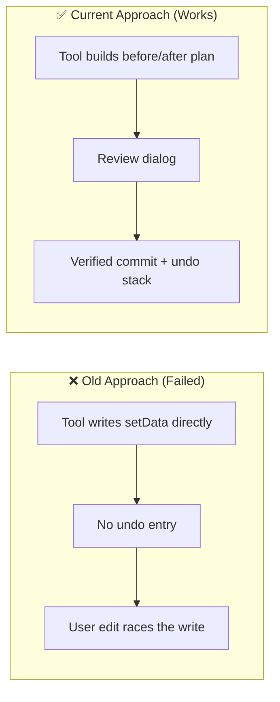

# Architectural Decisions, Pivots & Landmines (`DECISIONS_AND_TRAPS.md`)
> **1-Line Summary:** Why each non-obvious mechanism exists, which broken approach it replaced, and what must never be changed.

## 1. Architectural Decisions & Pivot History

### [DECISION: Plan-Preview-Commit-Only] | Aliases: no direct writes, transaction, review dialog
> **1-Line Summary:** Every canvas mutation is built as a reversible plan, reviewed by the user, then committed by one engine.
* **Decision Maker:** `[DECIDED BY: HUMAN]` (bundle invariant in the handover docs)
* **Original User Intention:** A bulk layout must never silently destroy an arrangement, and the user must see exactly what will change before it happens.
* **Options Considered:**
  * **Option A (Rejected):** Mutate the canvas in each tool. There is no undo, no diff, and a mid-way failure leaves a half-arranged canvas.
  * **Option B (Chosen):** Tools return a `Plan`; `OperationPreviewModal` commits it through `TransactionEngine`.
* **Visual Pivot Map (What Failed vs. What Works):**

* **Code Anchors (Grep Targets):**
  * `src/operations/TransactionEngine.ts` -> `commit`
  * `src/operations/OperationPreviewModal.ts` -> `applyChanges`
  * `src/ui/CanvasGeometryModal.ts` -> `preview`

### [DECISION: Whole-Canvas-Snapshots] | Aliases: replace-canvas, before, after, diff
> **1-Line Summary:** Each canvas change stores the complete model before and after, rather than a node-level patch.
* **Decision Maker:** `[DECIDED BY: HUMAN]`
* **Original User Intention:** Restoring must be exact even after layout, snapping, and anchor rewriting in one operation.
* **Options Considered:**
  * **Option A (Rejected):** Per-node patches. Restoring requires replaying inverse operations in order, and one missed field corrupts the canvas.
  * **Option B (Chosen):** Two snapshots, one file, one atomic write.
* **Code Anchors (Grep Targets):** `src/operations/OperationPlanner.ts` -> `canvasChange`

### [DECISION: Canonical-JSON-State-Match] | Aliases: stableCanvasJson, sorted keys, stale file
> **1-Line Summary:** Before and after writes compare a key-sorted JSON string, not raw file text.
* **Decision Maker:** `[DECIDED BY: HUMAN]`
* **Original User Intention:** A reformatted save by another plugin must not be treated as a user edit, and a real edit must never be overwritten.
* **Options Considered:**
  * **Option A (Rejected):** Compare raw strings. Any whitespace or key-order change aborts the transaction.
  * **Option B (Chosen):** Normalize objects recursively, then compare.
* **Code Anchors (Grep Targets):** `src/operations/TransactionEngine.ts` -> `stableCanvasJson`, `assertStateMatches`

### [DECISION: Append-Only-Markdown-Edits] | Aliases: wikilinks, footer, safe reconciliation
> **1-Line Summary:** Reconciliation only appends missing wikilinks at the end of a note; it never rewrites or removes paragraphs.
* **Decision Maker:** `[DECIDED BY: HUMAN]`
* **Original User Intention:** A synchronization pass must not damage prose or delete transclusions.
* **Options Considered:**
  * **Option A (Rejected):** Parse and rebuild the link section. Small formatting differences caused large diffs.
  * **Option B (Chosen):** Add `[[target]]` lines only when neither `[[target]]` nor `[[target|` already exists.
* **Code Anchors (Grep Targets):** `src/relationships/RelationshipEngine.ts` -> `planSemanticMarkdownLink`, `planSafeReconciliation`

### [DECISION: Auto-Sync-Off-By-Default] | Aliases: syncMode, apply, suggest, per-canvas rule
> **1-Line Summary:** Background reconciliation is opt-in, and **apply** commits without a review dialog only when the user chose it.
* **Decision Maker:** `[DECIDED BY: HUMAN]`
* **Original User Intention:** No surprise writes on file open; power users can still enable full sync.
* **Options Considered:**
  * **Option A (Rejected):** Default to **apply**. Merely opening a canvas would rewrite notes.
  * **Option B (Chosen):** Default **off**, per-canvas override, deduplicated **suggest** notice.
* **Code Anchors (Grep Targets):** `src/main.ts` -> `handleAutoSync`, `getCanvasRule`; `src/types.ts` -> `DEFAULT_SETTINGS`

### [DECISION: Host-Link-Index-As-Truth] | Aliases: metadataCache, resolvedLinks, unresolvedLinks
> **1-Line Summary:** Link reconciliation reads Obsidian's metadata cache instead of regex-scanning note bodies.
* **Decision Maker:** `[DECIDED BY: HUMAN]`
* **Original User Intention:** Aliases, embeds, headings, and unresolved targets must resolve exactly as Obsidian shows them.
* **Options Considered:**
  * **Option A (Rejected):** Regex `[[...]]` over file contents. It misses aliases, headings, and resolution rules.
  * **Option B (Chosen):** `resolvedLinks` for real edges, `unresolvedLinks` for broken ones.
* **Code Anchors (Grep Targets):** `src/relationships/RelationshipEngine.ts` -> `reconcile`

### [DECISION: Lossless-Canvas-Adapter] | Aliases: extra fields, round-trip, JSON Canvas
> **1-Line Summary:** Unknown node and edge keys are captured in `extra` and written back unchanged.
* **Decision Maker:** `[DECIDED BY: HUMAN]`
* **Original User Intention:** Future or third-party canvas fields must survive a layout run.
* **Options Considered:**
  * **Option A (Rejected):** Rebuild only known keys. Every write drops newer fields.
  * **Option B (Chosen):** Known-key allowlists plus `structuredClone` of everything else.
* **Code Anchors (Grep Targets):** `src/canvas/CanvasAdapter.ts` -> `extrasOf`, `toRawNode`, `toRawEdge`

### [DECISION: Media-Root-Prefix-Semantics] | Aliases: mediaRoots, folder boundary, normalizePath
> **1-Line Summary:** A media root matches the folder itself and its descendants, not any path that merely contains the name.
* **Decision Maker:** `[DECIDED BY: HUMAN]`
* **Original User Intention:** Restricting the picker to `Assets` must not also include `Old/Assets`.
* **Options Considered:**
  * **Option A (Rejected):** `path.includes(root)`. It matches sibling folders with the same name.
  * **Option B (Chosen):** Normalize slashes and require equality or a `root/` prefix.
* **Code Anchors (Grep Targets):** `src/media/MediaScanner.ts` -> `isUnderRoot`, `scan`

### [DECISION: Debounced-Media-Search] | Aliases: 120 ms, Escape, timer cleanup
> **1-Line Summary:** Picker search debounces grid rebuilds by 120 ms, Escape clears instantly, and the timer is cancelled on close.
* **Decision Maker:** `[DECIDED BY: HUMAN]`
* **Original User Intention:** Typing must not rebuild hundreds of cards per keystroke, and a closed modal must not keep working.
* **Options Considered:**
  * **Option A (Rejected):** Re-render on every `input` event. Large vaults jank and image loads restart.
  * **Option B (Chosen):** One pending timer, cleared on input, Escape, and close.
* **Code Anchors (Grep Targets):** `src/media/MediaPickerModal.ts` -> `render`, `onClose`

### [DECISION: Normalize-On-Load-Only] | Aliases: no version field, importConfiguration, clamp
> **1-Line Summary:** Settings have no version number; every load and import runs the same normalization pass.
* **Decision Maker:** `[DECIDED BY: HUMAN]`
* **Original User Intention:** Hand-edited or older `data.json` files must never produce invalid layout kinds, negative limits, or crash the plugin.
* **Options Considered:**
  * **Option A (Rejected):** Trust stored values and validate at use sites. Invalid data leaks into every consumer.
  * **Option B (Chosen):** One idempotent normalizer with clamps and enum fallbacks.
* **Code Anchors (Grep Targets):** `src/main.ts` -> `normalizeSettings`, `importConfiguration`

### [DECISION: Active-Canvas-Fast-Path] | Aliases: setData, requestSave, vault.process
> **1-Line Summary:** The canvas the user is looking at is written through the view, so it repaints immediately; any other canvas goes through `vault.process`.
* **Decision Maker:** `[DECIDED BY: HUMAN]`
* **Original User Intention:** A layout must appear instantly without a file reload, while background writes stay atomic.
* **Options Considered:**
  * **Option A (Rejected):** Always write the file. The open view can keep stale in-memory state and overwrite the change later.
  * **Option B (Chosen):** Compare the plan path with the adapter path and pick the correct write path.
* **Code Anchors (Grep Targets):** `src/operations/TransactionEngine.ts` -> `applyCanvas`, `readCanvas`

## 2. Landmines & Hard-Won Traps

### [TRAP: Stale-State-Must-Abort] | Aliases: assertStateMatches, force overwrite, user edit
> **1-Line Summary:** If a file no longer matches the preview snapshot, the transaction must throw, not repair and continue.
* **Why It Bites:** Undo/redo after a manual edit would silently discard the user's latest keystrokes or coordinates.
* **Rule:** Keep the comparison in `assertStateMatches` for commit, undo, and redo; never add a "force" path.
* **Code Anchors (Grep Targets):** `src/operations/TransactionEngine.ts` -> `assertStateMatches`, `undo`, `redo`

### [TRAP: Single-Active-Transaction] | Aliases: active flag, re-entrancy, auto sync
> **1-Line Summary:** `commit`, `undo`, and `redo` share one `active` lock; a second call refuses instead of queueing.
* **Why It Bites:** Canvas writes fire workspace events, which can trigger auto-sync and start a nested commit.
* **Rule:** Keep the `finally` that clears `active`; do not await unrelated work inside the lock.
* **Code Anchors (Grep Targets):** `src/operations/TransactionEngine.ts` -> `commit`, `undo`, `redo`

### [TRAP: Snapshot-Reversal-Order] | Aliases: applySnapshot, reverse, rollback
> **1-Line Summary:** Rolling back applies changes in reverse order, while rolling forward keeps plan order.
* **Why It Bites:** Two changes to the same file restored out of order pass one check and fail the next, leaving partial state.
* **Rule:** Keep `side === 'before' ? [...plan.changes].reverse() : plan.changes`.
* **Code Anchors (Grep Targets):** `src/operations/TransactionEngine.ts` -> `applySnapshot`

### [TRAP: Unknown-Canvas-Fields] | Aliases: extra, round-trip, data loss
> **1-Line Summary:** Any write that rebuilds nodes from known fields alone destroys fields Obsidian or other plugins added.
* **Why It Bites:** The layout looks correct, but plugin-specific data (colors, custom metadata) disappears.
* **Rule:** Always serialize through `CanvasAdapter.toRawData`, which spreads `extra` first.
* **Code Anchors (Grep Targets):** `src/canvas/CanvasAdapter.ts` -> `NODE_KEYS`, `EDGE_KEYS`, `extrasOf`

### [TRAP: Canvas-View-Is-Optional] | Aliases: view.canvas, mobile, getData
> **1-Line Summary:** `getViewType() === 'canvas'` is the only reliable guard; `canvas` itself is an undocumented optional object.
* **Why It Bites:** Assuming `canvas` exists throws on mobile or during view teardown, breaking every command at once.
* **Rule:** Build adapters only via `CanvasAdapter.fromView`, and keep all canvas calls optional-chained.
* **Code Anchors (Grep Targets):** `src/canvas/CanvasAdapter.ts` -> `fromView`, `getData`, `setData`

### [TRAP: Save-After-SetData] | Aliases: requestSave, repaint, persistence
> **1-Line Summary:** `setData` alone updates the live view but does not persist; `requestSave` must follow it.
* **Why It Bites:** The layout looks applied until Obsidian closes, then the file reverts.
* **Rule:** Keep `setData` and `save` paired in `applyCanvas`.
* **Code Anchors (Grep Targets):** `src/operations/TransactionEngine.ts` -> `applyCanvas`; `src/canvas/CanvasAdapter.ts` -> `save`

### [TRAP: Duplicate-Link-Tokens] | Aliases: [[x]], [[x|alias]], duplicate wikilink
> **1-Line Summary:** Existence checks must cover both the bare token and the aliased form before appending.
* **Why It Bites:** Appending `[[Note]]` next to `[[Note|display]]` creates a duplicate relationship in the graph.
* **Rule:** Check `[[dest]]` and `[[dest|` in both the direct and safe reconciliation paths.
* **Code Anchors (Grep Targets):** `src/relationships/RelationshipEngine.ts` -> `planSemanticMarkdownLink`, `planSafeReconciliation`

### [TRAP: Unlink-Is-Line-Anchored] | Aliases: regex, remove wikilink, standalone line
> **1-Line Summary:** Markdown removal only deletes a wikilink that occupies its own line; inline links are left alone.
* **Why It Bites:** A broad replace would delete link text inside sentences and break prose.
* **Rule:** Keep the `^\\s*(!?\\[\\[…(?:\\|…)?\\]\\])\\s*$` line-anchored regex and its escaping.
* **Code Anchors (Grep Targets):** `src/relationships/RelationshipEngine.ts` -> `planRemoveSemanticMarkdownLink`

### [TRAP: Semantic-Mode-Needs-Markdown] | Aliases: file node, .md, visual only
> **1-Line Summary:** Semantic linking throws unless both endpoints are file nodes pointing at Markdown notes.
* **Why It Bites:** A canvas-only card has no note to link, so a silent skip would produce a visual edge with no explanation.
* **Rule:** Keep the explicit error telling the user to use **Visual only** for non-Markdown elements.
* **Code Anchors (Grep Targets):** `src/relationships/RelationshipEngine.ts` -> `planConnect`, `planLinkNodes`

### [TRAP: Media-Root-Slash-Boundary] | Aliases: prefix, sibling folder, normalizePath
> **1-Line Summary:** Roots must be stripped of leading/trailing slashes and matched on a folder boundary.
* **Why It Bites:** Loose matching quietly widens the picker to unrelated folders.
* **Rule:** Keep `isUnderRoot` equality-or-`root/` logic and normalize before storing.
* **Code Anchors (Grep Targets):** `src/media/MediaScanner.ts` -> `isUnderRoot`; `src/main.ts` -> `normalizeSettings`

### [TRAP: Audio-Context-Availability] | Aliases: webkitAudioContext, decode limit, close
> **1-Line Summary:** Web Audio may be missing; decoding is capped at 900 seconds and the context must be closed.
* **Why It Bites:** An unclosed context leaks memory per opened file, and a missing constructor throws an opaque error.
* **Rule:** Keep the constructor check, the `try/finally` close, and the mtime-keyed cache.
* **Code Anchors (Grep Targets):** `src/media/AudioAnalyzer.ts` -> `analyze`, `clear`

### [TRAP: Playback-Timer-Cleanup] | Aliases: setInterval, onClose, detached modal
> **1-Line Summary:** The audio player polls progress every 100 ms and must clear that interval, pause, and drop the source on close.
* **Why It Bites:** A closed modal keeps ticking, and the browser keeps the decoded media alive.
* **Rule:** Keep the full `onClose` teardown.
* **Code Anchors (Grep Targets):** `src/media/AudioPlayerView.ts` -> `onClose`, `renderProgress`

### [TRAP: Auto-Sync-Notice-Spam] | Aliases: syncNoticeKey, dedupe, metadata change
> **1-Line Summary:** Auto-sync runs on every metadata change; the suggestion notice is deduplicated by a path-and-candidate key.
* **Why It Bites:** Saving one note would otherwise produce a notice per keystroke-triggered metadata event.
* **Rule:** Keep `syncNoticeKey` and reset it only when the counts drop to zero.
* **Code Anchors (Grep Targets):** `src/main.ts` -> `handleAutoSync`, `syncNoticeKey`

### [TRAP: Invalid-Preset-And-Rule-Data] | Aliases: layoutPresets, canvasRules, filter
> **1-Line Summary:** Presets and rules are validated by shape on load; invalid entries are dropped, not repaired.
* **Why It Bites:** A preset with an unknown `kind` would make the layout switch fall through and return the model unchanged, confusing the user.
* **Rule:** Keep `isValidPreset` and `isValidCanvasRule` aligned with the type unions when adding fields.
* **Code Anchors (Grep Targets):** `src/main.ts` -> `isValidPreset`, `isValidCanvasRule`

### [TRAP: Canvas-Without-Path] | Aliases: new untitled canvas, getPath null
> **1-Line Summary:** A canvas view can exist before it has a saved path; plans then carry an empty path.
* **Why It Bites:** The active-canvas fast path matches on path, so an empty path falls through to a file lookup that cannot find the file.
* **Rule:** Keep `getPath() ?? ''` at plan creation, and prefer the active adapter for writes.
* **Code Anchors (Grep Targets):** `src/canvas/CanvasAdapter.ts` -> `getPath`; `src/operations/OperationPlanner.ts` -> `canvasChange`

### [TRAP: Frozen-Runtime-Bundle] | Aliases: runtime/, fallback, no rebuild
> **1-Line Summary:** `runtime/main.js` is the emergency fallback and must never be regenerated or hand-edited by a source change.
* **Why It Bites:** Rebuilding overwrites the known-good bundle and removes the user's rollback path.
* **Rule:** Build only to the repository root; treat `runtime/` as read-only.
* **Code Anchors (Grep Targets):** `esbuild.config.mjs`, `runtime/main.js`
