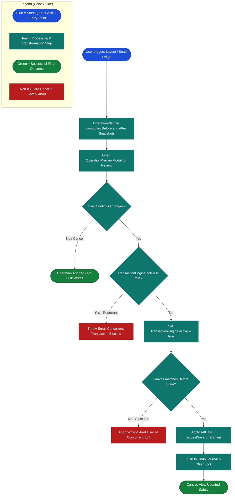
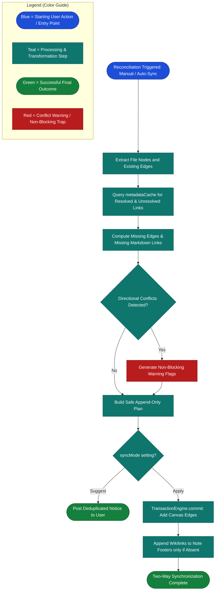

# Visual Feature & Change Log (`VISUAL_LOG.md`)
> **1-Line Summary:** Plain-English, color-coded Obsidian-compatible Mermaid flowcharts explaining how each major flow in Canvas Toolkit operates end to end.

## Feature & Change Flowcharts

### [VISUAL: Plan-Preview-Commit-Transaction-Flow] | Aliases: layout commit, transaction engine, operation planner
> **1-Line Summary:** How layout and geometry changes are converted into an atomic two-phase preview plan before committing to canvas and disk.

* **Plain-English Walkthrough:** When a user selects canvas cards and triggers a layout, alignment, or snapping action, the geometry engine creates an `OperationPlan` containing a whole-canvas snapshot of the before and after state. The user is presented with a visual preview dialog showing exactly what cards will move. Upon confirmation, the `TransactionEngine` acquires the exclusive active transaction lock, asserts that canonical JSON has not drifted, applies the update in-memory to the active view (`setData` + `requestSave`), and journals the change for undo/redo.

* **Code Anchors (Grep Targets):**
  * `src/operations/OperationPlanner.ts` -> `create`
  * `src/operations/TransactionEngine.ts` -> `commit`, `applySnapshot`
  * `src/operations/OperationPreviewModal.ts` -> `open`
  * `src/canvas/CanvasAdapter.ts` -> `setData`

---

### [VISUAL: Two-Way-Markdown-Canvas-Sync-Flow] | Aliases: wikilink sync, relationship engine, edge reconciliation
> **1-Line Summary:** How relationships between Canvas card nodes and Markdown notes are reconciled without deleting existing note contents.

* **Plain-English Walkthrough:** Canvas Toolkit periodically or on-demand inspects canvas file cards against Obsidian's `metadataCache`. It matches outgoing wikilinks against existing canvas edges. When missing connections are discovered, it creates a safe append-only synchronization plan: canvas edges are added directly, while Markdown links are appended to note footers only if not already present. Conflict warnings are displayed without blocking safe updates.

* **Code Anchors (Grep Targets):**
  * `src/relationships/RelationshipEngine.ts` -> `reconcile`
  * `src/main.ts` -> `reconcileCanvasRelationships`
  * `src/operations/TransactionEngine.ts` -> `commit`
